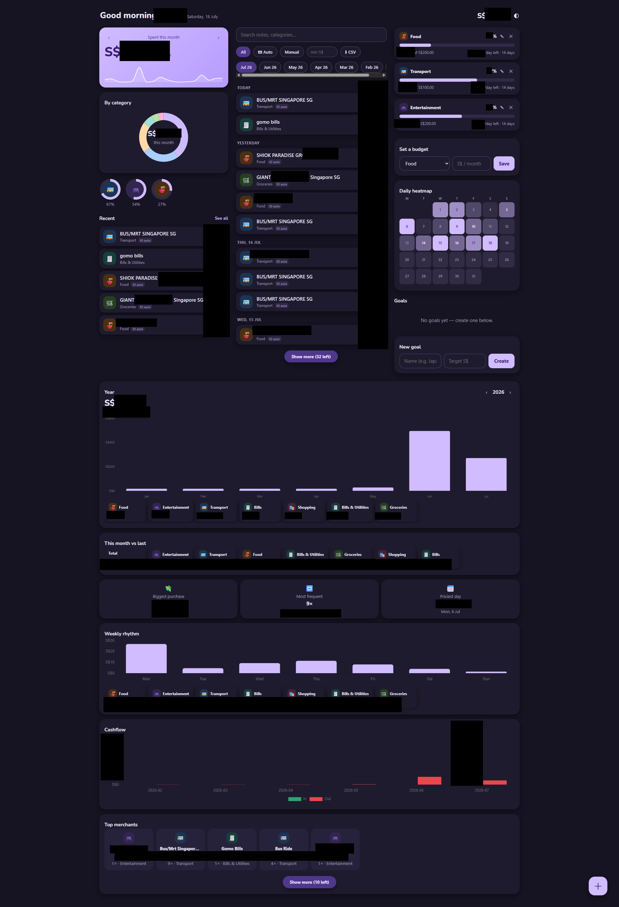

# expense-tracker

A self-hosted personal finance tracker for Singapore: a **Telegram bot** captures
spending the moment it happens, **bank/merchant emails are auto-imported**, and a
**mobile-first web dashboard** (PWA) does the analysis. Two small containers, one
SQLite file, no cloud services.

> Built for one user, one currency (SGD), one timezone (SGT) — on purpose.
> It replaces a commercial expense app with something that ingests my actual
> bank alerts and answers on my own hardware.


*The dashboard in dark mode — home, insights, budgets and merchant views (personal amounts redacted).*

## Highlights

- **Frictionless capture** — text the bot `kopi 2.80` and it's logged, categorised
  by keyword rules, with inline buttons to fix category or edit the note. Bare
  `/add` offers quick-add buttons based on your own frequent spends (median price).
- **Email auto-import** — polls Gmail over IMAP and parses transaction alerts from
  Trust Bank, Grab e-receipts, DBS PayLah!, DBS iBanking (PayNow), FairPrice Group
  app and ShopBack Pay. Anything else that *looks* like a receipt gets a
  suggest-and-confirm Telegram ping instead of silent auto-import — new merchants
  need zero code to at least surface.
- **Dedup that understands app payments** — a Grab order charged to a bank card
  fires *two* emails; the merchant receipt wins, the bank alert is skipped.
- **Reimbursements** — incoming PayNow can be linked back to the original expense
  as a negative row in its category, so monthly sums net out automatically.
- **Budgets, goals, recurring** — per-category budgets with pace alerts
  (projection > 110% after day 10), savings goals as allocations (never
  double-counted as transactions), recurring rules back-filled after downtime.
- **Insights dashboard** — month-over-month comparison, merchant breakdown,
  spending heatmap, cashflow, year view with per-category drill-down, weekly
  rhythm — Material You-styled vanilla JS + Chart.js, light/dark, installable PWA.
- **Daily digest & month-end report** — 23:59 SGT summary of everything recorded
  today; a report card with goal nudge on the 1st.

## Architecture

```
┌─────────────┐   long-poll   ┌──────────────┐
│  Telegram   │◄─────────────►│ expense-bot  │──┐  APScheduler:
└─────────────┘               │ (PTB v21)    │  │  recurring 00:10, digest 23:59,
                              └──────┬───────┘  │  IMAP poll every 15 min
┌─────────────┐    IMAP              │          │
│   Gmail     │◄─────────────────────┘          ▼
└─────────────┘                          ┌────────────┐
┌─────────────┐    HTTP    ┌──────────┐  │ SQLite DB  │
│  Browser /  │◄──────────►│expense-web│◄┤ (one file, │
│  PWA        │            │ (FastAPI) │  │ WAL mode)  │
└─────────────┘            └──────────┘  └────────────┘
```

- **Two services, one image** — the bot owns all scheduled side-effects; the web
  container only reads/writes the shared DB. Money is stored as **integer cents**.
- **Email ingestion is go-forward only** — first run seeds a high-water IMAP-UID
  cursor and never backfills, so historical overlap with imported data is impossible.
- **No JS framework, no build step** — vanilla JS SPA; Chart.js and fonts are
  fetched **at image build time** (no runtime CDN dependency).

## Quick start

Prereqs: Docker + Compose, a Telegram bot token from [@BotFather](https://t.me/BotFather),
your numeric chat ID from [@userinfobot](https://t.me/userinfobot).

```bash
cp .env.example .env        # set TELEGRAM_BOT_TOKEN + ALLOWED_CHAT_ID
docker compose up -d --build
```

The SQLite DB lands in `./data/` (bind mount — repoint the `volumes:` entries in
`compose.yaml` if you want it elsewhere).

Web dashboard: `http://<host>:8085`. The bot answers **only** `ALLOWED_CHAT_ID`
and silently ignores everyone else.

> ⚠️ **The web dashboard has no authentication.** Keep port 8085 on your LAN or
> behind a VPN/reverse-proxy with auth. Do not expose it to the internet as-is.

### Optional: email auto-import

Enable Google 2-Step Verification, create an **App Password**, then set
`GMAIL_USER` + `GMAIL_APP_PASSWORD` in `.env` and recreate the stack
(compose env changes need stop→start, not restart). Leave the password empty
to disable email polling entirely.

## Bot commands

| Command | Does |
|---|---|
| `kopi 2.80` (plain text) | quick-add with keyword categorisation |
| `/add [amount] [note]` | add; bare `/add` shows quick-add buttons |
| `/undo`, `/recent [n]`, `/find <text>` | fix-ups and lookup |
| `/summary [YYYY-MM]` | month summary |
| `/budget [Category amount]` | view / set budgets |
| `/income 5000 july salary` | record income |
| `/recurring add 1200 monthly 1 rent` | recurring rules (daily/weekly/monthly) |
| `/goal add Japan 3000` · `/goal put Japan 200` | savings goals |
| `/trip on\|off` | travel mode — route all new spends to Travel |

Every transaction message the bot sends carries ✏️ buttons (fix category / edit
note via stateless ForceReply — survives bot restarts).

## Email parsers

Parsing lives in `app/trust_email.py` — pure functions, no Telegram/DB imports,
unit-tested in `tests/test_trust_email.py` against anonymised copies of the real
HTML bodies (whitespace runs, entities and field order preserved). Currently:

| Sender | Imports |
|---|---|
| Trust Bank | card spends (local + overseas), outgoing PayNow; cancellations warn |
| Grab | food/mart orders (exact receipt time) and rides |
| DBS PayLah! | outgoing wallet spends; incoming money → suggest-as-income |
| DBS iBanking | outgoing account PayNow; incoming transfers → suggest-as-income |
| FairPrice app | app-payment receipts |
| ShopBack Pay | merchant + payment date; cashback notices ignored |
| *anyone else* | receipt-shaped emails → ✅ Add / ❌ Ignore suggestion |

## Tests

```bash
pip install -r requirements-dev.txt
pytest        # 163 tests: parsers, money math, DB, bot handlers, web API
```

## One-time history import

`import_cashew.py` loads a [Cashew](https://cashewapp.web.app/) CSV export
(`--dry-run` first, `--selftest` for the row transform), so email ingestion can
stay go-forward with no overlap.

## Conventions & limitations

- SGD only, integer cents, timestamps are local SGT ISO strings.
- Single user by design — one chat ID, one Gmail account, no auth on the web UI.
- Categories + alert thresholds: `app/config.py`; keyword rules: `app/categories.py`.
- The dashboard greeting name is per-device:
  `localStorage.setItem("expense.name", "Your Name")` in the browser console.
